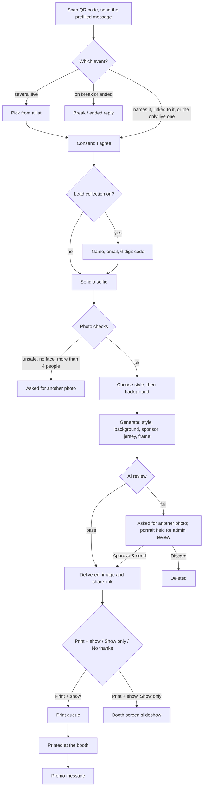

# How a portrait is made

From the attendee's first message to the print. [SPEC.md](../SPEC.md) has the full rules; the decision numbers (D-…)
point to [decisions.md](decisions.md).

## 1. Finding the event

The QR code on the booth screen opens WhatsApp or SMS with a message that names the event (D-37). That name links the
attendee's number to the event. Later messages go to the linked event, or to the only live event; with several live
events the attendee picks one. An event on break or ended answers with its own reply, and after an event ends its
attendees keep getting the ended reply until another event is live (D-13). Draft events are invisible.

## 2. Consent and leads

Nothing happens before the attendee taps **I agree** (the Twilio Privacy Notice is linked, D-19). If the event collects
leads, they also give their name and email and confirm it with a 6-digit code sent by email (Twilio Verify). Returning
attendees are recognised through Conversation Memory and skip what they already gave.

## 3. Photo checks

A selfie becomes a job and goes to the worker straight away, before any menu, so nobody picks a style for an unusable
photo (D-18). The worker checks, and replies at once if a check fails:

- **Moderation**: unsafe images are refused.
- **A face** must be visible.
- **1 to 4 people**: the people count is kept for generation and for group-photo wording later.
- **Quota**: each person gets `maxImagesPerPerson` portraits per event (counted per channel address).

A new photo during the menus replaces the old one.

## 4. Style and background

The attendee picks one of the event's styles, then one of its backgrounds. A menu with only one option is skipped.
Backgrounds are a fixed set, the photo's own background, the event's **uploaded** background, or the two LA Kings scenes.

## 5. Generation

One image call builds the portrait from the selfie and a prompt assembled from [PROMPTS.md](../PROMPTS.md) (D-01):

- the **style**, with the photo's people count and any pet
- the **background**. An uploaded one is not drawn: the person is generated on a transparent background and placed
  exactly onto the uploaded image.
- the **sponsor jersey**, when the event has the LA Kings promotion on: everyone wears the Kings jersey, with the
  reference images sent along (D-36)
- **frame clearance**, so heads stay out of the area the frame covers (D-27)

Then the event's **frame** is applied, and two files are stored: a 4x6 print PNG and a delivery JPEG.

## 6. AI review

A vision model compares the portrait with the selfie (same people, likeness, nothing badly broken). A pass is delivered
at once. A fail is **held for admin review**: the attendee is asked for another selfie, and an admin can still
**Approve & send** it or **Discard** it in the Review tab.

## 7. Delivery

- **WhatsApp**: the image with a share link. Outside WhatsApp's 24-hour window only the approved delivery template can
  be sent; without one the portrait stays on the share page.
- **SMS**: MMS with the image where carriers support it (US, CA, AU), otherwise the link only.
- The **share page** (`/s/<id>`) lets anyone with the link view, download and share it.

## 8. Booth screen and print

After delivery one question follows: **Print + show**, **Show only** or **No thanks**. Without printing (or with no
prints left) it is a plain "show on the booth screen?" yes/no.

- **Booth screen**: the portrait joins the slideshow at once (Twilio Sync push).
- **Print**: each person has `maxPrintsPerPerson` prints. The print agent on the booth laptop prints it on the DS620;
  after a successful print the attendee gets the event's promo message once. Prints can also be asked for later, by
  typing **print** in the chat or with the button on the share page (D-26, D-28).

## 9. Afterwards

- Selfies, portraits and share links **expire after 7 days**.
- An admin can **Remove** a delivered portrait: it leaves the booth screen, the share link stops working and its files
  are deleted (D-16). **Reprint** prints it again without using the attendee's quota.
- An attendee can ask in the chat to **delete their data**; after they confirm, everything about them is deleted
  (D-30). Free-text questions get a short AI reply in the event's language (D-29).
- Stats are counted throughout, without personal data.
